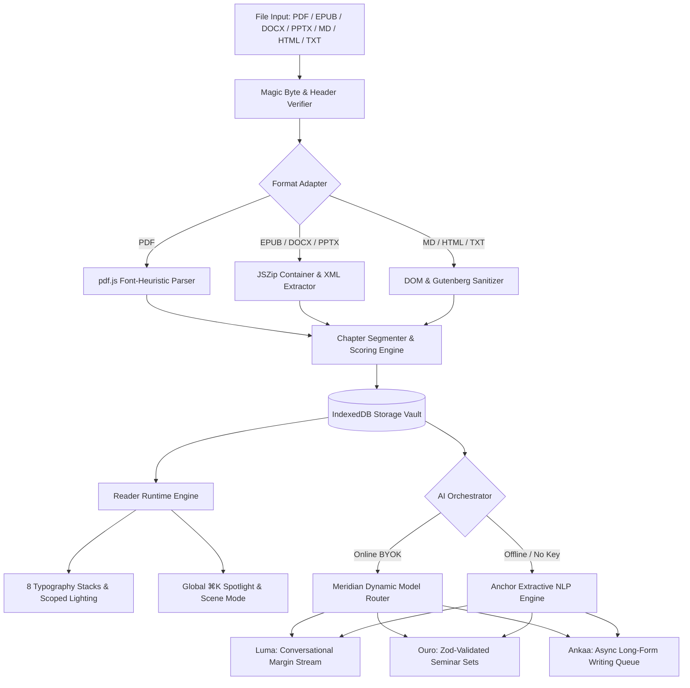

<div align="center">


### A local-first AI reading room where documents become living, interactive experiences.

[](https://www.typescriptlang.org/)
[](https://nextjs.org/)
[](https://tailwindcss.com/)
[](https://developer.mozilla.org/en-US/docs/Web/API/IndexedDB_API)
[](https://openrouter.ai/)
[](#license)

</div>

---

## ✦ Table of Contents

- [Overview](#-overview)
- [Core Architecture & Philosophy](#-core-architecture--philosophy)
- [System Pipeline](#-system-pipeline)
- [The Three Companions](#-the-three-companions)
- [Cinematic Reader & Typography](#-cinematic-reader--typography)
- [Document Ingestion & Magic Bytes](#-document-ingestion--magic-bytes)
- [Zero-Proxy AI & Security Model](#-zero-proxy-ai--security-model)
- [Design System ("Cloth & Gilt")](#-design-system-cloth--gilt)
- [Keyboard Shortcuts](#-keyboard-shortcuts)
- [Quick Start](#-quick-start)
- [Scripts & Tooling](#-scripts--tooling)
- [Development Environment](#-development-environment)
- [Deployment](#-deployment)
- [Releases](#-releases)
- [License](#-license)

---

## ✦ Overview

**Lemniscate** transforms static books, papers, slides, and stories into chapter-aware, interactive reading rooms. Built from first principles as a **local-first** engine, your library, reading positions, highlights, and study sets live strictly within your browser's IndexedDB storage.

When connected to an API key, three dedicated AI companions operate directly in the margins — answering questions, crafting seminar-grade study sets, and generating long-form writing desks. The online layer routes intelligently: question-relevant context is assembled by BM25 passage retrieval rather than blind text slices, structured outputs self-repair once before falling back, sampling temperature adapts to the task (literary generation runs hot, JSON extraction cold), and an adaptive health loop reorders model fallback chains from your own observed success/latency history. When offline or without an API key, the built-in **Anchor** engine executes grounded NLP entirely on-device — true TextRank summarization (sentence-graph PageRank + MMR redundancy control), BM25 passage retrieval with quoted evidence for offline Q&A, YAKE-inspired keyword extraction with bigram motif detection, morphological stemming, word-boundary mood classification and fully deterministic quiz generation — ensuring uninterrupted reading flow with zero network calls.

---

## ✦ Core Architecture & Philosophy

```
  ┌─────────────────────────────────────────────────────────────┐
  │                    LOCAL-FIRST BROWSER RUNTIME              │
  ├───────────────┬───────────────────────────────┬─────────────┤
  │ Ingestion     │ Client-Side Parsers (pdf.js,  │ Magic Byte  │
  │ Engine        │ JSZip for EPUB/DOCX/PPTX)     │ Validation  │
  ├───────────────┼───────────────────────────────┼─────────────┤
  │ Persistence   │ IndexedDB (lemniscate)       │ Zero Cloud  │
  │ Vault         │ Anonymous Identity Partition  │ Databases   │
  ├───────────────┼───────────────────────────────┼─────────────┤
  │ Orchestration │ Meridian (Free Model Router)  │ Anchor (100%│
  │ Layer         │ Direct Browser → Provider     │ Offline NLP)│
  ├───────────────┼───────────────────────────────┼─────────────┤
  │ Reader        │ 8 Editorial Font Stacks       │ Scene View, │
  │ Runtime       │ 3 Lighting Scopes, Bookmarks  │ Virtualized │
  └───────────────┴───────────────────────────────┴─────────────┘
```

1. **Local-First & Sovereign**: Everything runs on the client device. Nothing leaves the browser unless you invoke an AI companion — and the one flow that can send imported text (import refinement) asks first, with an explicit consent gate that can be revoked in Settings.
2. **Zero-Proxy BYOK**: No backend server proxies or middleman servers. The browser communicates directly with whichever provider you connected in Settings (OpenRouter, Gemini, Grok, Groq, Mistral or Cerebras) using a session-scoped in-memory API key.
3. **Graceful Offline Degradation**: If network drops or no key is provided, the **Anchor** engine seamlessly fulfills companion interactions via extractive algorithms.
4. **Clean Layered Separation**:
   $$\text{Input} \longrightarrow \text{Ingestion Pipeline} \longrightarrow \text{Structured Data} \longrightarrow \text{Runtime Engine} \longrightarrow \text{UI}$$

---

## ✦ System Pipeline



---

## ✦ The Three Companions

Lemniscate introduces three specialized companions operating alongside your reading flow:

| Companion | Archetype                      | Capabilities                                                                                                                                                                                                                            | Offline Mode (Anchor)                                                                           |
| :-------- | :----------------------------- | :-------------------------------------------------------------------------------------------------------------------------------------------------------------------------------------------------------------------------------------- | :---------------------------------------------------------------------------------------------- |
| **Luma**  | _Marginalia Conversationalist_ | Token-by-token SSE streaming, contextual chapter citations, quote extraction, conversational depth, markdown-lite rendering.                                                                                                            | Extractive text search with heuristic sentence scoring and quotation ranking.                   |
| **Ouro**  | _Seminar & Study Architect_    | Generates comprehensive study sets: Executive summaries, thematic breakdowns, character rosters, vocabulary, sourced quizzes, flashcards, and essay prompts. Validated with strict **Zod schemas** and cached 7 days per document hash. | Deterministic extraction of key vocabulary, structural summaries, and passage-level flashcards. |
| **Ankaa** | _Writing & Synthesis Desk_     | Drafts long-form essays, critiques, and creative extensions (~2,500 words online / ~1,800 words offline). Managed via an **asynchronous background job queue** with live word counts, step trackers, and crash recovery.                | Multi-pass heuristic expansion synthesizing chapter segments into structured drafts.            |

---

## ✦ Cinematic Reader & Typography

The reader interface is designed to disappear, leaving only the narrative.

### Typography Stacks

Research-backed typography engineered specifically for sustained long-form reading:

- **Literata**: Modern digital book face designed for Google Play Books.
- **EB Garamond**: Classic Renaissance elegance with true book proportions.
- **Spectral**: Crisp, contemporary editorial serif created for screen legibility.
- **Source Serif 4**: Adobe's open-source editorial workhorse.
- **Georgia**: High-contrast, robust system serif.
- **Bookerly**: Amazon Kindle's purpose-built reading face.
- **Baskerville**: High-contrast transitional serif with classical weight.
- **Palatino**: Hermann Zapf's humanist Renaissance masterpiece.

### Lighting & Contrast Scopes

- **Obsidian Dark**: Warm near-black backgrounds (`#08070a` to `#15131b`) with amber undertones.
- **Vellum Light**: Soft, low-glare parchment surface (`#f7f4ed`) tailored for daylight.
- **Parchment Sepia**: Warm nostalgic paper tone (`#f0e3c9`) with earthen contrast.
- **High-Contrast Toggle**: Intensifies text contrast across all three lighting scopes.

### Reading Controls

- **Cinematic Scene Mode (`s`)**: Isolates dialogue and action into focused theatrical beats.
- **In-Document Search (`/`)**: Instant client-side fuzzy search across all chapters.
- **Text Controls**: Granular adjustments for font size, line height, paragraph spacing, measure width, and decorative drop-caps.
- **Bookmarks & Annotations (`b`)**: Multi-colored highlights, margin notes, and instant review trays.

---

## ✦ Document Ingestion & Magic Bytes

To ensure safety and reliability, Lemniscate validates all uploaded files using **magic bytes** rather than trusting client-reported MIME types:

| Format         | Magic Bytes / Header                            | Ingestion Adapter                  | Output Structure                                             |
| :------------- | :---------------------------------------------- | :--------------------------------- | :----------------------------------------------------------- |
| **PDF**        | `%PDF-` (`0x25 0x50 0x44 0x46 0x2D`)            | `pdfjs-dist` (Worker-isolated)     | Font-size heuristic chapters & structural sections           |
| **EPUB**       | `PK\x03\x04` (`mimetype: application/epub+zip`) | `JSZip` Container & OPF Spine Walk | Ordered spine items transformed into native chapters         |
| **DOCX**       | `PK\x03\x04` (`word/document.xml`)              | `JSZip` XML Parser                 | Heading-style mapped chapters and paragraph preservation     |
| **PPTX**       | `PK\x03\x04` (`ppt/presentation.xml`)           | `JSZip` XML Slide Extractor        | Individual slides formatted as discrete readable chapters    |
| **Markdown**   | Text UTF-8 Validation                           | Native Regex Parser                | ATX (`#`) and Setext (`===`) heading hierarchies             |
| **HTML**       | `<!DOCTYPE html` or `<html>`                    | DOMParser + Readability Sanitizer  | Stripped boilerplate, extracted main prose chapters          |
| **Plain Text** | UTF-8 / ASCII Byte Validation                   | Boilerplate Stripper               | Project Gutenberg header/footer sanitization, chapter splits |

---

## ✦ Zero-Proxy AI & Security Model

```
  ┌─────────────────┐        Direct HTTPS (Bearer Key)        ┌─────────────────┐
  │  User Browser   │ ──────────────────────────────────────> │  AI Provider    │
  │  (Lemniscate)   │ <────────────────────────────────────── │  (Catalog/LLM)  │
  └─────────────────┘             SSE Stream Tokens           └─────────────────┘
           │
           │ Key in Memory Only (Evaporates on Tab Close)
           ▼
  ┌─────────────────┐
  │  No Proxy API   │
  │  No Telemetry   │
  │  No Remote DB   │
  └─────────────────┘
```

- **Session-Scoped Memory Keys**: API keys are stored in runtime JavaScript memory only. They are never written to `localStorage`, `IndexedDB`, or server logs. Closing the browser tab destroys the key instantly.
- **Zero Middleman Proxy**: There are no intermediary `/api/ai` endpoints. Requests flow directly between your browser and the connected provider over TLS.
- **Delimiter-Fenced Prompts**: Document excerpts are wrapped in strict `<<<document_content>>>` boundary fences with system-prompt grounding to prevent prompt-injection attacks.
- **Anonymous Identity**: All local IndexedDB records are stamped with an on-device anonymous session UUID.

---

## ✦ Design System ("Cloth & Gilt")

Lemniscate is styled using Tailwind CSS v4's `@theme` directive, grounded in the physical world of a private library: deep green buckram bindings, gilt spine lettering, bone paper, ink. The UI type pairs **Cormorant Garamond** (display serif — title pages and spine letters) with **Instrument Sans** (UI) and **JetBrains Mono** (keystrokes & data). Reader surfaces carry three independent lighting scopes — **Cloth** (dark), **Vellum** (paper), **Parchment** (sepia).

```css
/* Palette Tokens */
--color-ink-950: #0d1210; /* Deep cloth green-black */
--color-ink-900: #111815; /* Reading room canvas */
--color-mist-100: #efeae0; /* Primary bone text */
--color-gold-500: #c9a24b; /* The one accent — antique gilt */

/* Companion Accent Tokens */
--color-ouro-500: #55917e; /* Study pine */
--color-ankaa-500: #d5854f; /* Writing ember */
--color-ok-500: #6cbb81; /* Reading moss */
```

Dynamic accent switching (`data-accent="ouro | ankaa | ok"`) dynamically recalibrates the entire application's focus rings, badges, and progress through centralized CSS custom properties. Feedback uses [Sonner](https://sonner.emilkowal.ski/) (stacked, swipeable toasts bridged to the app's toast store) and animated stat numerals via [NumberFlow](https://number-flow.barvian.me/).

---

## ✦ Keyboard Shortcuts

| Shortcut                                                     | Scope    | Action                              |
| :----------------------------------------------------------- | :------- | :---------------------------------- |
| <kbd>⌘</kbd> + <kbd>K</kbd> / <kbd>Ctrl</kbd> + <kbd>K</kbd> | Global   | Open Universal Spotlight Search     |
| <kbd>Alt</kbd> + <kbd>→</kbd>                                | Reader   | Advance to Next Chapter             |
| <kbd>Alt</kbd> + <kbd>←</kbd>                                | Reader   | Return to Previous Chapter          |
| <kbd>/</kbd>                                                 | Reader   | Open In-Document Search             |
| <kbd>L</kbd>                                                 | Reader   | Toggle Luma & Ouro Margin Drawer    |
| <kbd>T</kbd>                                                 | Reader   | Toggle Table of Contents Drawer     |
| <kbd>B</kbd>                                                 | Reader   | Add Bookmark / View Annotations     |
| <kbd>S</kbd>                                                 | Reader   | Toggle Cinematic Scene Mode         |
| <kbd>Esc</kbd>                                               | Overlays | Dismiss Modal / Close Active Drawer |

---

## ✦ Quick Start

### Prerequisites

- **Runtime**: [Bun](https://bun.sh) `>= 1.1` (or Node.js `>= 20`)
- **Package Manager**: Bun (recommended) or npm/pnpm/yarn

### 1. Clone & Install

```bash
git clone https://github.com/Pushyanth02/Lemniscate.git
cd Lemniscate
bun install
```

### 2. Launch Local Dev Server

```bash
bun run dev
```

Open **[http://localhost:3000](http://localhost:3000)**. The library starts empty — nothing is seeded automatically. You can import your own documents, or load two optional sample books from the Library's empty state (explicitly opt-in, never fabricated history).

### 3. Verify Your Setup

```bash
bun test                  # unit tests via bun's built-in runner (bun:test)
bun run check:pdf-worker  # committed pdf.js worker matches installed pdfjs-dist
```

---

## ✦ Scripts & Tooling

```bash
# Start local development server on port 3000
bun run dev

# Run TypeScript strict type-checking
bun run typecheck

# Run ESLint validation (0 errors, 0 warnings)
bun run lint

# Compile the production static export (written to .next-build/, kept
# separate from the dev server's .next/ via NEXT_DIST_DIR)
bun run build

# Remove build artifacts (.next/, .next-build/, out/)
bun run clean

# Run the test suite (bun:test — Bun's built-in runner; the suite grows
# with the codebase, so no count is promised here)
bun run test

# Verify the committed pdf.js worker matches the installed pdfjs-dist
bun run check:pdf-worker

# Run the full local CI gate: lint + typecheck + bun test + production
# static-export build (the same pipeline as .github/workflows/ci.yml)
bun run ci
```

---

## ✦ Development Environment

### VS Code (recommended)

The repository ships a complete VS Code setup:

- **`.vscode/extensions.json`** — on first open, VS Code offers to install
  ESLint, Tailwind CSS IntelliSense, EditorConfig, GitHub Actions, and
  GitHub Pull Requests support.
- **`.vscode/settings.json`** — workspace TypeScript SDK (`node_modules`),
  ESLint fix-on-save, explorer / search / watcher exclusions for build
  output and `dev.log`, plus git auto-fetch and branch protection for the
  release lines (`main`, `master`).
- **`.vscode/launch.json`** — **F5** launches Chrome against the dev server on
  `:3000` with source maps; an attach-to-Chrome (`:9222`) config is included.
- **`.vscode/tasks.json`** — Terminal → Run Task entries for `dev`, `lint`,
  `typecheck`, `test`, `build` (production static export), and `e2e` (the
  26-step browser journey against the dev server).
- **`.editorconfig`** keeps every other editor (Vim, JetBrains, the GitHub web
  editor) on the same LF / 2-space / final-newline conventions.

### GitHub

- **CI**: `.github/workflows/ci.yml` runs on every push and PR to `main`
  and `master` (and on demand via *Run workflow*) —
  Bun 1.3.14 (frozen lockfile) → ESLint → `tsc --noEmit` → `bun test` →
  production static-export build → export-output gate → PDF-worker alignment.
- **Dependabot** (`.github/dependabot.yml`) keeps npm dependencies and Actions
  versions current weekly; deliberate pins (`next`, `pdfjs-dist`, Bun) are
  reviewed by hand.
- Issue templates (`.github/ISSUE_TEMPLATE/`), a pull-request template, and
  `CODEOWNERS` are included; a `SECURITY.md` policy covers private
  vulnerability reporting; contribution ground rules live in
  `CONTRIBUTING.md`.

---

## ✦ Deployment

Lemniscate is a **static export**: `bun run build` produces a fully
client-rendered site (IndexedDB storage, no backend, no serverless
functions). The build runs isolated in `.next-build/` so it never touches a
running dev server's `.next/` cache, and the export lands **in
`.next-build/` itself** (with a custom `distDir`, Next uses it as the export
output directory).

### Vercel

```bash
bunx vercel --prod
```

Or import the GitHub repository in the Vercel dashboard — the framework is
auto-detected as **Next.js**, and because `next.config.ts` sets
`output: "export"`, the plain `next build` emits the fully static site, which
Vercel serves as-is: no backend, no serverless functions.

`vercel.json` ships with the project:

- Security headers on every route: `X-Content-Type-Options: nosniff`,
  `X-Frame-Options: DENY`, `Referrer-Policy`, `Permissions-Policy`
  (camera / microphone / geolocation denied), and HSTS.
- `Cache-Control: no-cache` for `sw.js` (a service worker must never be served
  stale) and immutable one-year caching for the content-hashed fonts in
  `public/fonts/`.

One environmental difference to know: locally, `bun run build` isolates the
export into `.next-build/` (via `NEXT_DIST_DIR`) so a manual production build
can never corrupt a running dev server's `.next/` cache; on Vercel there is
no dev server, the framework builds plainly (`next build`), and the static
output is served automatically.

### Any static host

```bash
bun run build
# deploy the .next-build/ directory (it contains index.html at its root)
```

To serve the export locally (a quick smoke check):

```bash
cd .next-build && python3 -m http.server 3210
```

### End-to-end verification

The browser journey (`tests/browser/e2e-journey.sh`) runs the audit's
critical user path — import → read → progress → bookmark → reload → export
→ new profile → restore → device erasure → reload — against a running
instance:

```bash
# against the dev server
BASE=http://localhost:3000 bun run e2e

# against a served production export
cd .next-build && python3 -m http.server 3210 &
BASE=http://localhost:3210 bun run e2e
```

It requires the `agent-browser` CLI. The backup fixture it restores is
regenerated with `bun tests/browser/make-fixture.ts` (the app's own
export code path, run in-process).

---

## ✦ Releases

### v1.1 — Mobile layout hardening (October 2026)

Four fixes driven by a real-device review at 390 px:

- **Grid blowout eliminated.** Every responsive grid now carries an explicit
  mobile column template (`grid-cols-1 …`). Previously, grids that only
  declared `sm:`/`lg:` columns fell back to implicit *auto* tracks below the
  breakpoint — and auto tracks size by **min-content**, so one long
  truncating line (a chapter title, an activity row) could inflate the whole
  track to ~408 px on a 390 px screen and clip cards past the viewport edge
  with no ellipsis in sight. Hardened across the dashboard (widgets,
  continue-reading, notes), landing (hero, CTA, features, marginalia,
  companions, instruments), library, insights, upload, create, settings
  sections, reader panels and the scene atlas.
- **Continue-reading cards reworked.** "N min left" now sits on its own
  short line so it can never be pushed out of view; multi-chapter books show
  the chapter title on a second, truncating line (single-chapter documents
  omit it — it only repeated the cover title).
- **Switch tracks restored.** The blanket 44 px touch-target minimum (coarse
  pointers, and the "Larger touch targets" preference) no longer applies to
  `role="switch"` controls — it was stretching the 44×24 toggle track into a
  44×44 block with the knob pinned at its top. The whole settings row
  remains the tap target (label activation), so reachability is unchanged.
- **Settings sections fully visible on mobile.** The section nav now wraps
  into a pill cloud instead of a single off-screen scroll strip with a
  hidden scrollbar — which made Accessibility, AI companions, Import & data
  and About invisible to first-time visitors.
- **Landing header fits 390 px.** The gold "Enter the room" pill shortens
  to "Enter" under `sm` (full label from `sm` up; the mobile menu keeps the
  full-size CTA).
- **Responsive `hidden` now actually hides `Button`/`IconBtn`.** Both
  components ship a base `inline-flex` that — by Tailwind's stylesheet
  ordering — beat any call-site `hidden`, so the reader's "Reader settings"
  and "Keyboard shortcuts" toolbar buttons (and the landing header's
  "Library" button) rendered on phones they were designed to hide,
  crowding the 320 px toolbar past the viewport. The base display class is
  now dropped whenever the caller passes `hidden`, and the reader passes
  WCAG's 320 px reflow check with zero horizontal overflow.

### v1 — First full release (October 2026)

Single-commit baseline: the local-first reading room — ingestion pipeline
(PDF / EPUB / DOCX / PPTX / MD / HTML / TXT with magic-byte validation),
cinematic reader with 8 type stacks and 3 lighting scopes, three AI
companions (Luma, Ouro, Ankaa) with the offline Anchor engine, zero-proxy
BYOK routing, the full backup / restore / erase ladder, SEO surface
(sitemap, robots, llms.txt, structured data), CI pipeline and browser e2e
journey.

---

## ✦ License

Private & proprietary. All rights reserved.
